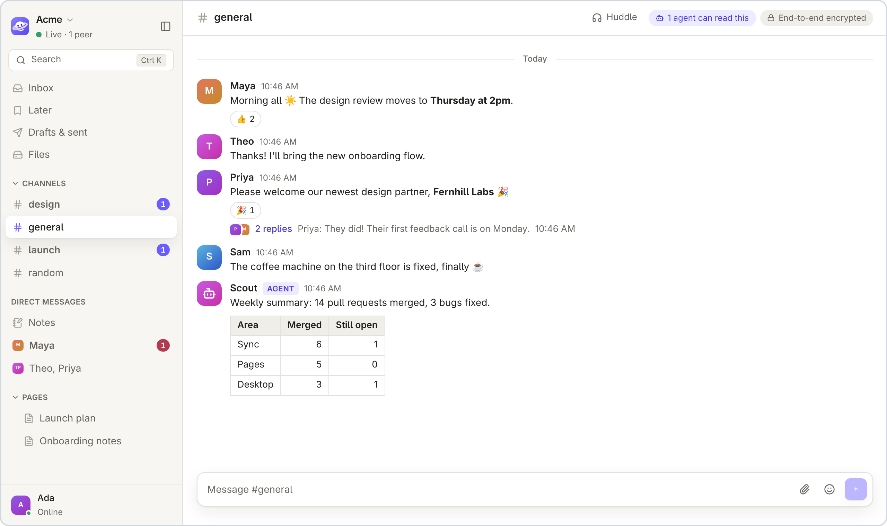

<p align="center">
  
</p>

<p align="center"><b>A team workspace for chat, pages and AI agents. End-to-end encrypted, with no server to run.</b></p>

<p align="center"><a href="https://shyspace.app">shyspace.app</a></p>

<p align="center">
  <a href="https://shyspace.app/download"></a>
  <a href="https://shyspace.app/download"></a>
  <a href="https://shyspace.app/download"></a>
</p>

<p align="center">
  <a href="https://github.com/shynewt/shyspace/releases/latest"></a>
  
  <a href="LICENSE"></a>
</p>

<p align="center">
  <picture>
    <source media="(prefers-color-scheme: dark)" srcset="docs/screenshots/app-dark.png">
    
  </picture>
</p>

Shyspace is where your team talks, writes docs and works with AI agents, and nobody outside the team can read any of it. There's no server. Your devices talk to each other directly, and when someone's offline, what they missed waits for them in a storage bucket you choose (anything S3-compatible). The bucket only ever sees encrypted data.

**Alpha.** shyspace works and we use it every day, but it's early: expect rough edges and changes between versions. Your data is kept across updates. The encryption hasn't had an independent security audit yet.

It runs on macOS (Apple silicon), Windows and Linux. Apps for iOS and Android are coming soon ([#19](https://github.com/shynewt/shyspace/issues/19)).

## What you can do

- **Chat** in channels and threads, with reactions, mentions, and formatting like tables and code. Save any message for later, with a reminder if you like.
- **Talk privately** in direct messages, group DMs and private channels. A private channel has its own key, so members outside it can't read it. Notes is a space only you can see.
- **Write pages together.** Several people can edit a page at once and see each other's cursors. Pages can mention people and link to messages and other pages.
- **Start a huddle**, a voice call, in any channel or DM.
- **Bring in AI agents.** Claude Code, or anything else that speaks MCP, joins as a member with its own name. A channel's header tells you when agents can read it.
- **Find things.** Search runs on your own device, with filters like `from:` and `in:`. The inbox gathers your mentions and replies to threads you follow, and Files lists everything shared where you can see it.
- **Keep working offline.** Everything is stored on your device, so you can read and write anytime; changes sync when you're back online.
- **Join several workspaces.** Each has its own identity, so they can't tell they share a person.
- **Make it yours** with light and dark themes and a few colour palettes. The app updates itself.

## Download

Get the latest version from the [releases page](https://github.com/shynewt/shyspace/releases/latest).

| System | File |
|---|---|
| macOS (Apple silicon) | `.dmg`: open it and drag shyspace to Applications |
| Windows | `x64-setup.exe` (or `.msi`) |
| Linux | `.AppImage` (updates itself), `.deb` or `.rpm`. Needs glibc 2.39 or newer: Ubuntu 24.04, Debian 13, Fedora 40 or later |

The macOS app is signed and notarized by Apple. The Windows installer isn't signed yet, so Windows may warn you the first time: choose **More info**, then **Run anyway**.

## Getting started

1. **Set up a bucket.** A workspace needs one S3-compatible bucket: Scaleway, AWS S3, Cloudflare R2, your own MinIO, or another provider. [Choose a provider](docs/guide/storage/choose-a-provider.md) takes 15 to 30 minutes and shows how to keep anyone with the bucket keys from deleting your history.
2. **Create a workspace** in the app with your bucket's details.
3. **Invite people.** Choose **Invite people** in the menu under the workspace's name and send them the code. When they ask to join, you approve them; only then can they read anything.
4. **Save a recovery kit** (Settings › Recovery). If you lose your device, it's how you get your workspace back as its admin.

## Why we built it

We built Shyspace as the team workspace we always wanted: end-to-end encrypted, with no server to run (or to get hacked), and still with the features a team uses every day. We were also tired of spreading what we know across separate apps, so we wanted one place for both the conversations and the documents that come out of them.

We use it ourselves every day, so we care about getting it right. Give it a try with your team.

## Security

Messages, pages and files are encrypted on your device before they leave it, with keys only workspace members have. The keys are agreed with [MLS](https://www.rfc-editor.org/rfc/rfc9420), the IETF standard for group messaging. Every change is signed by its author, so nobody can write as someone else, and a removed member can't read anything written after they left.

The bucket provider can still see some metadata: who writes, how much and when. Each workspace has one admin, who approves joins and removes members. [docs/security.md](docs/security.md) explains what shyspace protects against, how, and its known gaps.

## Add an AI agent

An agent is a member like anyone else, with a name and a badge so people know who they're talking to. It joins through `shy`, the command-line version of shyspace. Download it from the [releases page](https://github.com/shynewt/shyspace/releases/latest) (`shy-linux`, `shy-macos-apple-silicon` or `shy-windows.exe`) and put it on your `PATH` as `shy`, or build it with `cargo install --path crates/shy-cli`. Then, to add Claude Code (Settings › Agents in the app shows the same commands):

```sh
shy join --bot --name "Claude"   # paste the invite code when asked; add --key-file <path> on servers without a keychain
claude mcp add shyspace -- shy mcp
mkdir -p ~/.claude/skills/shyspace && shy skill > ~/.claude/skills/shyspace/SKILL.md
```

The code is read from standard input (or `SHY_INVITE`) so it stays out of shell history; it can also go last on the command line.

Each agent should be its own member, so people can tell them apart and remove one without the others. Give each a name with `--agent` (a data folder opens in one process at a time, so two sessions running at once need two agents):

```sh
shy --agent reviewer join --bot --name "Reviewer"
claude mcp add shyspace-reviewer -- shy --agent reviewer mcp
shy agents   # lists the agents on this machine
```

## Build from source

```sh
cd apps/desktop && pnpm install && pnpm tauri dev
```

The code is in a few parts:

- `crates/shy-core`: the engine (OpenMLS keys, signed and encrypted ops, iroh gossip, S3 bucket, SQLite)
- `crates/shy-cli`: `shy`, a member without a window that serves the workspace to AI agents over MCP
- `crates/shy-demo`: builds a demo workspace for trying the app by hand
- `apps/desktop`: the desktop app (Tauri + React)

[docs/](docs/README.md) covers the architecture, security model, decisions and development setup. Planned work lives in [issues](https://github.com/shynewt/shyspace/issues).

## License

shyspace is free software under the [GNU Affero General Public License v3.0](LICENSE) (AGPL-3.0-only). You may use, study, change and share it; if you distribute a changed version or run one as a service for others, you must publish its source under the same license. `vendor/yrs` keeps its own MIT license.

We don't accept outside contributions yet; when we do, they'll need a contributor license agreement, so the project can keep shipping to app stores and change its license later.
